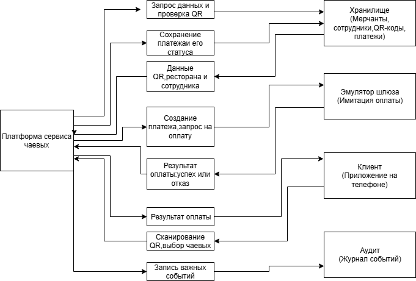
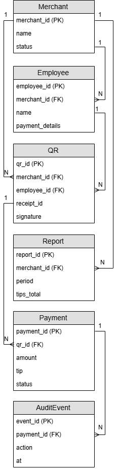
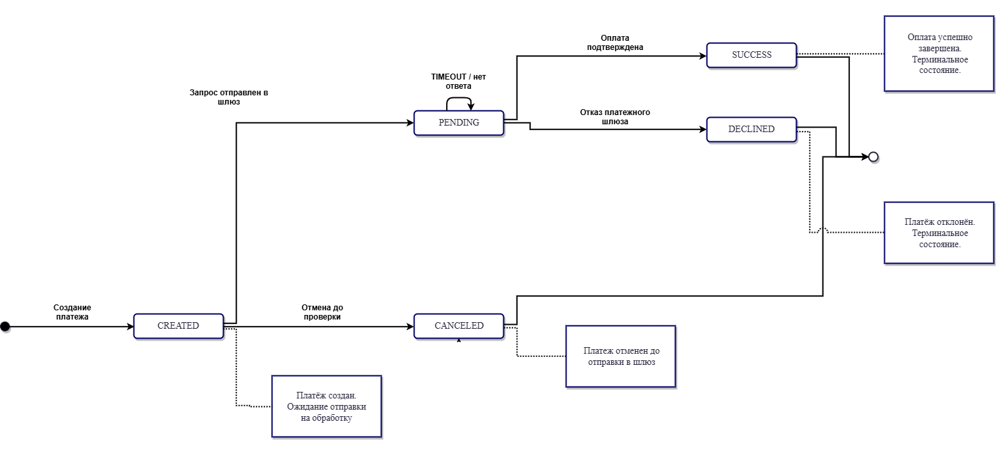

# Приложение к презентации — кейс 3 «Онлайн-чаевые»

## Команда: Отдел контента

## A. Диаграммы

### A.1. Схема системы (обязательно)

|Блок|Что это|Что передаёт|
|-|-|-|
|Клиент|приложение на телефоне|QR-код, выбор чаевых|
|Платформа|сервис чаевых|Запрос на проверку данных на корректность и соответствие правилам, суммы чека и чаевых, статусы платежей|
|Эмулятор шлюза|заглушка для банка|Одобрение (SUCCESS) или отказ (DECLINED) транзакции|
|Хранилище|База данных (CSV/PostgreSQL)|Данные о мерчантах, официантах, QR-кодах и суммах платежей|
|Аудит|Журнал событий (AuditEvent)|Логи смены статусов (кто и когда создал/отменил платеж)|

### A.2. ER-модель 
#### Диаграмма сущностей:

### A.3. Схема состояний платежа 

## B. Таблицы

### B.1. Правила QR и платежа 

## Таблица — проверки QR

|ID|Проверка|Действие|Код ошибки|
|-|-|-|-|
|Q-3|nonce уже использован|отклонить|QR_USED|
|Q-4|Статус ресторана BLOCKED|отклонить|MERCHANT_BLOCKED|
|Q-5|Номер чека НЕ совпадает с QR|отклонить|EMPLOYEE_NOT_FOUND|
|Q-6|Текущее время + 10 минут(допустимый лаг сети)|продолжить|QR_LINK_EXPIRED|

## Таблица — правила платежа

|ID|Условие|Действие|Код ошибки|
|-|-|-|-|
|P-1|base\_amount ≤ 0 или > 1 000 000|отклонить|AMOUNT\_OUT\_OF\_RANGE|
|P-2|Повторный idempotency_key|Вернуть предыдущий результат|HTTP 200|
|P-3|Итоговая сумма > 2 000 000|Отклонить|AMOUNT_OUT_OF_RANGE|
|P-4|Отмена платежа в статусе PENDING|Запретить|CANCEL_NOT_ALLOWED|

### B.2. Матрица «ситуация → код ошибки → HTTP → retryable»

|Ситуация|Код ошибки|HTTP|retryable|
|-|-|-|-|
|Подпись QR не совпала|INVALID\_QR|422|нет|
|QR истёк|QR\_EXPIRED|410|да (новый QR)|
|nonce использован|QR\_USED|409|нет|
|merchant BLOCKED|MERCHANT\_BLOCKED|403|нет|
|Сумма чека (amount) ≤ 0 или > 1 000 000|AMOUNT_INVALID|400|нет|
|Сумма чаевых (tip) > 50% от чека|TIP_LIMIT_EXCEEDED|400|нет|
|Реквизиты сотрудника переданы в открытом виде|INVALID_PAYMENT_DETAILS|422|нет|
|Подпись QR не совпала с HMAC-SHA256|INVALID_SIGNATURE|422|нет|

### B.3. Тесты 

## T3-1. Успех (ОБРАЗЕЦ)
**Вход:** qr_001, base=637.00, tip_pct=5
**Ожидание:** SUCCESS, amount_total=668.85, tip=31.85

**Факт:**   
*  "payment_id": "p_demo_001",
*  "status": "SUCCESS",
*  "gateway_status": "SUCCESS",
*  "amount_total": 668.85,
*  "tip_amount": 31.85,
*  "error_code": null **Пройден:** [x] да [ ] нет

## T3-2. Отказ шлюза
**Вход:** qr_003, base=911.00, tip_pct=15
**Ожидание:** DECLINED, CARD_DECLINED

**Факт:** 
*  "status": "DECLINED",
*  "error_code": "CARD_DECLINED",
*  "message": "Банк отклонил операцию" **Пройден:** [x] да [ ] нет

## T3-3. Неверный QR
**Вход:** QR с испорченной подписью
**Ожидание:** INVALID_QR (422) или QR_EXPIRED (410), платёж не создан

**Факт:**  
*  "status": "ERROR",
*  "error_code": "INVALID_QR",
*  "extra": {
*  "reason": "qr not found" **Пройден:** [x] да [ ] нет

## T3-4. Повтор
**Вход:** тот же idempotency_key дважды
**Ожидание:** тот же payment_id, одна строка в payments.csv

**Факт:** 
*  "status": "SUCCESS",
*  "message": "Платеж уже был проведен ранее (Идемпотентность)" **Пройден:** [x] да [] нет

## T3-5. Отмена
**Вход:** создать платёж, отменить до подтверждения
**Ожидание:** CANCELED; отмена из PENDING → 409

**Факт:** 
*  "status": "ERROR",
*  "error_code": "409_CONFLICT",
*  "message": "Нельзя отменить, платеж уже завершен" **Пройден:** [x] да [] нет

## Прототип на python

import csv
import hashlib
import hmac
import json
import os
import sys
from datetime import datetime, timezone
from openpyxl import load_workbook

SECRET = b"demo-secret-k3"
BASE_DIR = os.path.dirname(os.path.abspath(__file__))
XLSX_PATH = os.path.join(BASE_DIR, "merchants.xlsx")
OUT_CSV = os.path.join(BASE_DIR, "payments_out.csv")

OUT_FIELDS = ["payment_id", "merchant_id", "employee_id",
              "amount", "tip", "status", "timestamp"]

MERCHANT_OK_STATUS = "ACTIVE"

def _load_sheet_rows(ws, key_field):
    rows = list(ws.iter_rows(values_only=True))
    if not rows:
        return {}
    headers = [str(h).strip() if h is not None else "" for h in rows[0]]
    result = {}
    for raw in rows[1:]:
        if raw is None or all(v is None for v in raw):
            continue
        row = {headers[i]: ("" if raw[i] is None else str(raw[i]).strip())
               for i in range(len(headers))}
        key = row.get(key_field, "")
        if key:
            result[key] = row
    return result

def load_qr(qr_id):
    wb = load_workbook(XLSX_PATH, read_only=True, data_only=True)
    try:
        if "qr_links" not in wb.sheetnames:
            raise RuntimeError("Лист 'qr_links' не найден")
        qr_map = _load_sheet_rows(wb["qr_links"], "qr_id")
        return qr_map.get(qr_id)
    finally:
        wb.close()

def get_merchant(merchant_id):
    wb = load_workbook(XLSX_PATH, read_only=True, data_only=True)
    try:
        if "merchants" not in wb.sheetnames:
            raise RuntimeError("Лист 'merchants' не найден")
        m_map = _load_sheet_rows(wb["merchants"], "merchant_id")
        return m_map.get(merchant_id)
    finally:
        wb.close()

def verify_signature(qr):
    payload = f"{qr['merchant_id']}|{qr['employee_id']}|{qr['receipt_id']}|{qr['nonce']}|{qr['exp']}"
    expected = hmac.new(SECRET, payload.encode(), hashlib.sha256).hexdigest()[:16]
    return hmac.compare_digest(expected, qr.get("signature", ""))

def check_exp(qr):
    #ВРЕМЕННО ОТКЛЮЧЕНО ДЛЯ ТЕСТОВ
    return True

def calc_amounts(base, pct):
    tip = round(base * pct / 100, 2)
    return tip, round(base + tip, 2)

#чисто для тестов
def emulate_gateway(qr_id, nonce):
    if qr_id == "qr_001":
        return "SUCCESS", None
    if qr_id == "qr_003":
        return "DECLINED", "CARD_DECLINED"
    if qr_id == "qr_008":
        return "TIMEOUT", "GATEWAY_TIMEOUT"

    h = int(hashlib.md5((qr_id + nonce).encode()).hexdigest(), 16) % 10
    if h <= 7:
        return "SUCCESS", None
    if h == 8:
        return "DECLINED", "CARD_DECLINED"
    return "TIMEOUT", "GATEWAY_TIMEOUT"

def _existing_payment_ids():
    if not os.path.exists(OUT_CSV):
        return set()
    with open(OUT_CSV, encoding="utf-8") as f:
        return {row["payment_id"] for row in csv.DictReader(f)}

def _make_payment_id(qr_id, existing):
    suffix = qr_id[-3:]
    candidate = f"p_demo_{suffix}"
    i = 1
    while candidate in existing:
        i += 1
        candidate = f"p_demo_{suffix}_{i}"
    return candidate

def is_already_paid(qr_id):
    if not os.path.exists(OUT_CSV):
        return False
    with open(OUT_CSV, encoding="utf-8") as f:
        reader = csv.DictReader(f)
        for row in reader:
            if row["payment_id"].startswith(f"p_demo_{qr_id[-3:]}"):
                if row["status"] in ("SUCCESS", "PENDING"):
                    return True
    return False

def write_payment(payment):
    new_file = not os.path.exists(OUT_CSV)
    with open(OUT_CSV, "a", newline="", encoding="utf-8") as f:
        w = csv.DictWriter(f, fieldnames=OUT_FIELDS)
        if new_file:
            w.writeheader()
        w.writerow(payment)

def cancel_payment(qr_id):
    if not os.path.exists(OUT_CSV):
        return False, "404_NOT_FOUND"
    with open(OUT_CSV, mode='r', encoding="utf-8") as f:
        reader = csv.DictReader(f)
        rows = list(reader)
        fieldnames = reader.fieldnames

    found = False
    for row in rows:
        if row["payment_id"].startswith(f"p_demo_{qr_id[-3:]}"):
            if row["status"] == "PENDING":
                row["status"] = "CANCELED"
                found = True
            elif row["status"] in ("SUCCESS", "CANCELED"):
                return False, "409_CONFLICT"

    if found:
        with open(OUT_CSV, mode='w', newline='', encoding="utf-8") as f:
            writer = csv.DictWriter(f, fieldnames=fieldnames)
            writer.writeheader()
            writer.writerows(rows)
        return True, "OK"
    return False, "404_NOT_FOUND"

def _fail(code, exit_code=2, **extra):
    payload = {"status": "ERROR", "error_code": code}
    payload.update(extra)
    print(json.dumps(payload, ensure_ascii=False, indent=2))
    sys.exit(exit_code)

def main():
    print("=" * 50)
    print("  ПРОТОТИП ПЛАТФОРМЫ ЧАЕВЫХ (ТЕСТИРОВАНИЕ)")
    print("=" * 50)

    qr_id = input("Введите QR-код: ").strip() or "qr_001"

    base_str = input("Сумма чека (Enter - 1500): ").strip()
    base = float(base_str) if base_str else 1500.0

    pct_str = input("% чаевых (Enter - 10): ").strip()
    pct = float(pct_str) if pct_str else 10.0

    is_cancel_mode = input("Это отмена платежа? (y/n): ").strip().lower() == 'y'

    print("\n--- РЕЗУЛЬТАТ ---")

    if is_cancel_mode:
        success, reason = cancel_payment(qr_id)
        if success:
            print(json.dumps({"status": "CANCELED", "message": "Платеж отменен"}, ensure_ascii=False, indent=2))
            sys.exit(0)
        elif reason == "409_CONFLICT":
            print(json.dumps(
                {"status": "ERROR", "error_code": "409_CONFLICT", "message": "Нельзя отменить, платеж уже завершен"},
                ensure_ascii=False, indent=2))
            sys.exit(1)
        else:
            print(json.dumps({"status": "ERROR", "error_code": "400_BAD_REQUEST", "message": "Платеж не найден"},
                             ensure_ascii=False, indent=2))
            sys.exit(1)

    qr = load_qr(qr_id)
    if not qr:
        _fail("INVALID_QR", extra={"reason": "qr not found"})
    if not verify_signature(qr):
        _fail("INVALID_QR", extra={"reason": "bad signature"})
    if not check_exp(qr):
        _fail("EXPIRED_QR")

    merchant = get_merchant(qr["merchant_id"])
    if not merchant:
        _fail("INVALID_MERCHANT", extra={"reason": "merchant not found"})
    if merchant.get("status") != MERCHANT_OK_STATUS:
        _fail("MERCHANT_NOT_ACTIVE", extra={"merchant_status": merchant.get("status")})

    if is_already_paid(qr_id):
        print(json.dumps({
            "status": "SUCCESS",
            "message": "Платеж уже был проведен ранее (Идемпотентность)",
        }, ensure_ascii=False, indent=2))
        sys.exit(0)

    gw_status, error = emulate_gateway(qr_id, qr["nonce"])
    if gw_status == "DECLINED":
        print(json.dumps({
            "status": "DECLINED",
            "error_code": error,
            "message": "Банк отклонил операцию"
        }, ensure_ascii=False, indent=2))

        payment_id = _make_payment_id(qr_id, _existing_payment_ids())

        write_payment({
            "payment_id": payment_id, "merchant_id": qr["merchant_id"], "employee_id": qr["employee_id"],
            "amount": "0.00", "tip": "0.00", "status": "DECLINED",
            "timestamp": datetime.now(timezone.utc).strftime("%Y-%m-%dT%H:%M:%SZ")
        })
        sys.exit(1)
    tip, total = calc_amounts(base, pct)
    report_status = "PENDING" if gw_status == "TIMEOUT" else gw_status
    payment_id = _make_payment_id(qr_id, _existing_payment_ids())

    write_payment({
        "payment_id": payment_id, "merchant_id": qr["merchant_id"], "employee_id": qr["employee_id"],
        "amount": f"{base:.2f}", "tip": f"{tip:.2f}", "status": report_status,
        "timestamp": datetime.now(timezone.utc).strftime("%Y-%m-%dT%H:%M:%SZ")
    })

    print(json.dumps({
        "payment_id": payment_id,
        "status": report_status,
        "gateway_status": gw_status,
        "amount_total": total,
        "tip_amount": tip,
        "error_code": error,
    }, ensure_ascii=False, indent=2))

    sys.exit(0 if gw_status == "SUCCESS" else 1)

if __name__ == "__main__":
    main()

## C. Журнал промптов (обязательно)

Минимум 5 строк. Формат:

|Дата|Цель|Промпт (сжато)|Результат|Проверка|Использовано|
|-|-|-|-|-|-|
|2025-11-01|Понять HMAC|«объясни HMAC на примере»|код|сверил с эталоном|да|
|2025-11-05|Схема сущностей|"Как правильно нарисовать ER-диаграмму в draw.io для схемы сущностей?"|Небольшая инструкция по схемам сущностей, разбор значений 1 и N|Сверил с ТЗ и Excel|да|
|2025-11-05|Проверка логики тестов|"Почему в тест-кейсах важен статус платежа для идемпотентности?"|Объяснение логики проверки дублей при оплате|Сверил с ТЗ-4|да|
|2025-11-06|Расчет метрик для отчета|"Какая формула нужна для расчета среднего процента чаевых?"|Формула `AVG(tip / amount) * 100`|Пересчитал по payments.csv|да|
|2025-11-06|Написание сценария|"Помоги описать процесс регистрации сотрудника с маскировкой реквизитов"|Черновик 4 шагов регистрации|Дописал детали под свой кейс|переработано|
|2025-11-06|Поиск ошибок в коде|"Почему мой код на Python выдает ошибку при проверке подписи HMAC?"|Подсказка про формат `hexdigest` и `encode()`|Исправил в 04_прототип.py|да|

## D. Матрица вклада (обязательно)

|Участник|Файлы / задачи|Часы|Подпись|
|-|-|-|-|
|Иванов И.|02\_правила.md, 03\_тесты.md, защита слайдов 4 и 7|12||
|Шакирова К.|02\_правила.md, 02\_roles.md, 03\_data_dictionary.md, 05\_api_schemas done.yami, 06\_qr_and_tip_dialog done.md, 06\_приложение.md|11||
|Мухтарова Д.|02\_правила.md, 02\_roles.md, 03\_data_dictionary.md, 04\_requirements.md, 07\_payment_em...tor_template.md, 11\_ИБ.md, 06\_приложение.md|11||
|Шайхетдинова Д.|02\_правила.md, 02\_roles.md, 03\_тесты.md, 08\_errors.md, 09\_reports.md, 05\_презентация.md, 04\_прототип.md, 06\_приложение.md|11||

## E. Артефакты

Ссылка на git-ветку: https://github.com/di668/Case3-Otdel_kontenta.git

## F. Чек-лист приложения

* \[ ] Схема системы: 5–6 блоков, потоки подписаны
* \[ ] Схема состояний платежа
* \[ ] ER-модель (если бонус) или перечисление сущностей
* \[ ] Правила Q-1…Q-6, P-1…P-4 с обоснованием
* \[ ] Матрица «ситуация → код → HTTP → retryable»
* \[ ] Тесты T3-1…T3-5 с фактом
* \[ ] Журнал промптов: 5+ строк
* \[ ] Матрица вклада: 4 человека, задачи разные
* \[ ] Git-ветка и коммит
* \[ ] Экспорт в PDF до защиты

